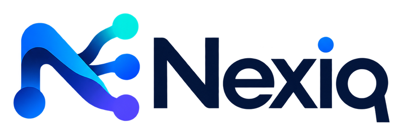

  

<h3 align="center">An exchange for conditional prediction markets</h3>

  <em>IF a condition happens, THEN the outcome settles. If it does not, the market is voided and everyone is refunded.</em>

---

## What we build

Nexiq is an exchange built around conditional markets: a trade on an outcome
that only counts if its condition is met. The whole system is written in C++23
for low, predictable latency on the hot path.

| Component | Role |
| --- | --- |
| **matching-engine** | Order book and price-time matching |
| **risk-engine** | Pre-trade risk: buying power, positions, holds, YES/NO |
| **nexiq-protocol** | The event bus wire format and its codec |
| **AeronDpdk** | Transport: a DPDK media driver speaking Aeron |

The engine knows nothing about prediction markets, and the transport knows
nothing about orders. Services talk to each other only through
`nexiq-protocol` messages.

## Principles

- Measure, do not assert: a performance claim comes with a benchmark.
- No allocation on a hot path.
- Rejects are values, exceptions signal bugs.
- Every line is written to be read later, under pressure, while a book is live.
